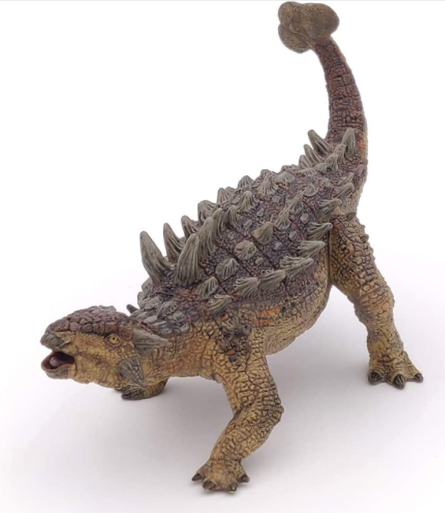
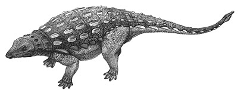
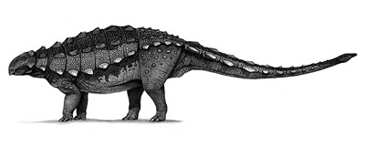

# you uploaded an Ankylosaurus.

The Ankylosaurus was 7 meters long. It was larger than 60.2% of the dinosaurs in our dataset.
<iframe src="assets/ank_length.html" width="500" height="500" frameborder="0"></iframe>

The Ankylosaurus was a herbivore, similar to about 57.9% of the dinosaurs in the Cretaceous Period.
<iframe src="assets/ank_diet.html" width="500" height="500" frameborder="0"></iframe>

The Ankylosaurus was never lonely. By taxonomy, it was closest to the

cedarpelta

and the

gobisaurus

